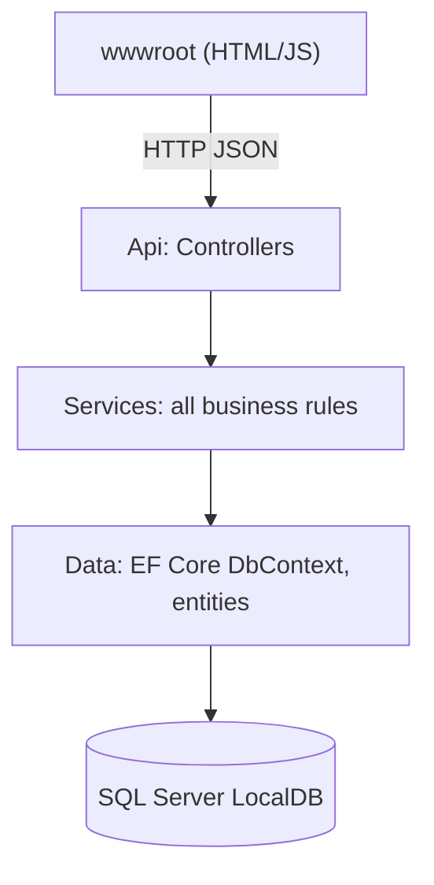
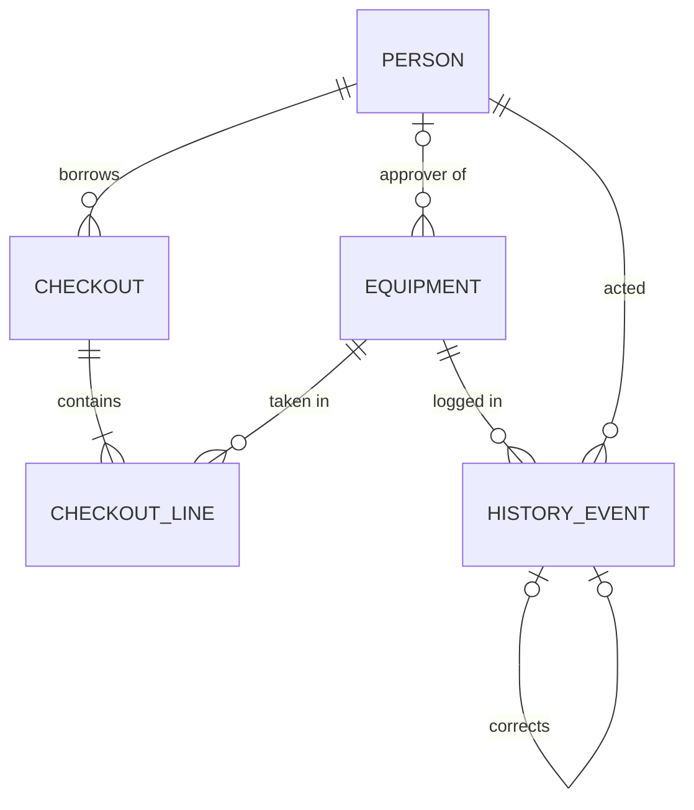

# Architecture Spine: Equipment-Tracker

## Design Paradigm

Layered, single deployable. Dependencies point downward only.



| Layer | Folder | Holds |
| --- | --- | --- |
| Api | `src/EquipmentTracker.Api/Controllers` | Routing, request/response DTOs, mapping to HTTP status. No rules. |
| Services | `src/EquipmentTracker.Api/Services` | Every business rule: availability, checkout, approval, return, restore, history, PIN and role checks. |
| Data | `src/EquipmentTracker.Api/Data` | Entities, `AppDbContext`, migrations, seed. |
| UI | `src/EquipmentTracker.Api/wwwroot` | Static HTML/JS served by the same process. Calls the API only. |

## Invariants & Rules

### AD-1 — Rules live only in services

- **Binds:** all FRs
- **Prevents:** a rule enforced in the UI or a controller but bypassed elsewhere
- **Rule:** controllers and the UI never decide availability, permission or state transitions. Every rule is in a service method and covered by a test.

### AD-2 — Current state plus append-only event log

- **Binds:** FR-15, FR-21, FR-25, FR-26, FR-27
- **Prevents:** history that disagrees with current state, or edited history
- **Rule:** current state lives in `Equipment` and `CheckoutLine`. Every state change also inserts exactly one `HistoryEvent` row in the same database transaction. `HistoryEvent` rows are never updated or deleted; no endpoint or service method updates or deletes them. A correction is a new event with `CorrectsEventId` set.

### AD-3 — Availability is computed in one place

- **Binds:** FR-8, FR-10, FR-13, FR-20, FR-23
- **Prevents:** screens and checkout disagreeing about what is available
- **Rule:** `AvailabilityService` is the only code that computes availability.
  - Individual: available iff `Condition = OK` and no line in `PendingApproval` or `Out`.
  - Quantity: `usable = TotalQuantity − DamagedQuantity`; `available = usable − Σ(Quantity − ReturnedQuantity)` over lines in `Out` (and `PendingApproval`, which holds units too).

### AD-4 — Checkout line state machine

- **Binds:** FR-12..FR-14, FR-16, FR-19
- **Prevents:** equipment marked out before approval, or lost partial returns
- **Rule:** `CheckoutLine.Status` moves only `PendingApproval → Out`, `PendingApproval → Rejected`, `Out → Returned`. A line is created `Out` if its item has no approval, otherwise `PendingApproval`. A checkout is open while any of its lines is `PendingApproval` or `Out`. A partial return increments `ReturnedQuantity`; the line becomes `Returned` only when `ReturnedQuantity = Quantity`.

### AD-5 — Concurrency is optimistic, per equipment row

- **Binds:** NFR-3, FR-10, FR-13
- **Prevents:** two people taking the same item at the same moment
- **Rule:** `Equipment` has a `rowversion` concurrency token. Any operation that changes availability loads the item, checks AD-3, and writes it (touching the token) inside one transaction. A `DbUpdateConcurrencyException` becomes HTTP 409 and the UI asks the user to retry.

### AD-6 — Identity is a person id; consequential actions need a PIN

- **Binds:** FR-3, FR-5, FR-6, FR-14, FR-21, NFR-4
- **Prevents:** extra auth machinery, or unprotected sensitive actions
- **Rule:** there are no sessions or tokens. The UI sends the chosen person as the `X-Person-Id` header. Approve, reject, restore, correction and all management endpoints also require `pin` in the request body; a service verifies it against the stored hash (ASP.NET Core `PasswordHasher`) and checks the permission: approver must be the item's named approver; restore needs Office or Owner; management and corrections need Owner. Borrow, return and read endpoints need no PIN. Never return a PIN or hash.

### AD-7 — Time

- **Binds:** FR-9, FR-23, FR-25
- **Prevents:** overdue disagreements and untestable time logic
- **Rule:** timestamps are stored in UTC. `DueDate` is a date only (`DateOnly`, `date` column). "Today" and overdue are evaluated in Pakistan Standard Time. Services take `TimeProvider` so tests control the clock. Overdue iff today > `DueDate` for a line not yet fully returned.

### AD-8 — Error shape

- **Binds:** NFR-1, all endpoints
- **Prevents:** the UI having to parse several error formats
- **Rule:** all failures return `ProblemDetails` JSON: 400 invalid input or broken rule, 403 wrong person or PIN, 404 not found, 409 concurrency. The `detail` field is a message safe to show to the user. Services throw a small set of domain exceptions that one middleware maps to these.

## Consistency Conventions

| Concern | Convention |
| --- | --- |
| Naming | C# PascalCase; entities singular (`Equipment`, `Person`, `Checkout`, `CheckoutLine`, `HistoryEvent`); endpoints under `/api/...` in lowercase plural |
| Data and formats | `int` identity keys; enums stored as strings; JSON camelCase; dates `yyyy-MM-dd`, timestamps ISO 8601 UTC |
| State and cross-cutting | EF Core only (no raw SQL); services are scoped, no static state; configuration in `appsettings.json`; no PINs in logs |

## Stack

| Name | Version |
| --- | --- |
| .NET (target framework) | net8.0 (built with installed SDK 9.0.315; .NET 8 runtime installed) |
| ASP.NET Core Web API | 8.0 |
| Entity Framework Core + SqlServer provider | 8.0.x |
| SQL Server | LocalDB (`(localdb)\MSSQLLocalDB`) |
| Frontend | Plain HTML, CSS and JavaScript (no build step) |
| Tests | xUnit, run against a real LocalDB test database |

## Structural Seed

```text
EquipmentTracker.sln
src/EquipmentTracker.Api/
  Controllers/  Services/  Data/  Middleware/  wwwroot/
  Program.cs  appsettings.json
tests/EquipmentTracker.Tests/
```



Deployment: one Kestrel process on localhost serves the API and `wwwroot`; the database is LocalDB, created by `Database.Migrate()` and seeded on first start. Run with `dotnet run`.

## Capability → Architecture Map

| Area | Lives in | Governed by |
| --- | --- | --- |
| Equipment and people (FR-1..5) | `Data`, `EquipmentService`, `PeopleService` | AD-1, AD-6 |
| Checkout (FR-6..11) | `CheckoutService`, `AvailabilityService` | AD-1, AD-3, AD-4, AD-5 |
| Approval (FR-12..16) | `ApprovalService` | AD-2, AD-4, AD-6 |
| Return and condition (FR-17..21) | `ReturnService`, `RestoreService` | AD-2, AD-3, AD-4 |
| Visibility (FR-22..24) | `StatusService`, wwwroot current screen | AD-3, AD-7 |
| History (FR-25..27) | `HistoryService` | AD-2 |
| NFRs | all | AD-5, AD-6, AD-8, tests |

## Deferred

- PIN reset and change flow: Owner edits a person to set a new PIN.
- Paging of the history list: the dataset is small.
- Hosting beyond localhost, HTTPS and backup: not needed for the assessment.
- Frontend framework: plain JS is enough for six screens.
